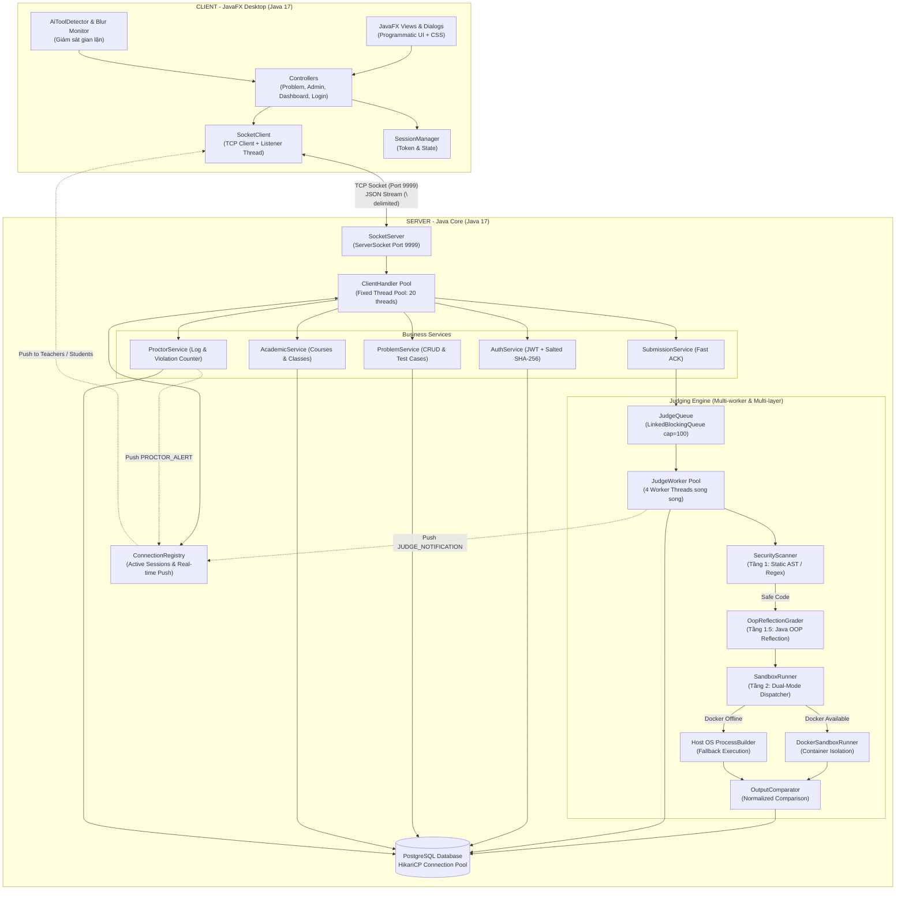
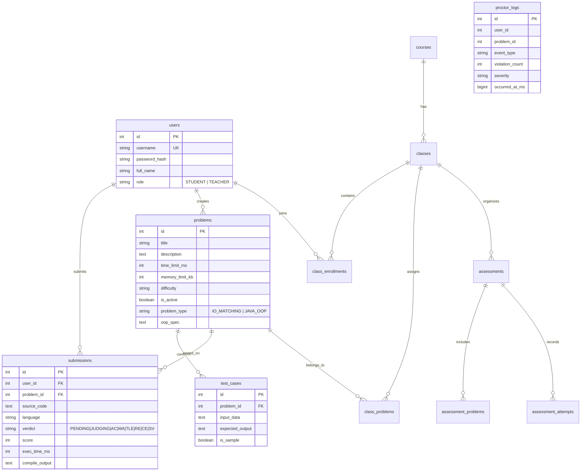

# 🏗️ Kiến Trúc Hệ Thống Chấm Code Tự Động (Networked Auto-Grader)

> BTL Lập Trình Mạng — Học kỳ 2026–2027  
> Định hướng đề tài: **Topic 4.5 – Networked Auto-Grader**  
> Tiêu chí: **Bám sát thực tế mã nguồn, tối giản, chính xác và tập trung vào bản chất Network Programming**.

---

## 1. Phân Tích Yêu Cầu Đề Bài

Từ [Instruction.md](file:///d:/26.Ki_7/3.LTM/ltm_code_judge/final-project/Instruction.md) và [Topics.md](file:///d:/26.Ki_7/3.LTM/ltm_code_judge/final-project/Topics.md), hệ thống đáp ứng đầy đủ các tiêu chuẩn cốt lõi:

| # | Yêu cầu nghiệp vụ & kỹ thuật | Thành phần đáp ứng trong hệ thống |
|:--|:-----------------------------|:----------------------------------|
| 1 | **System Architecture** | Mô hình phân tầng Client → TCP Network → Server → Queue → Worker Pool |
| 2 | **Network Communication** | Kết nối TCP Socket bền vững (Persistent Connection) qua Port `9999` |
| 3 | **Protocol / Message Format** | Giao thức JSON phân tách theo dòng (`\n`), đồng bộ 2 chiều |
| 4 | **Concurrency & Multithreading** | Client Handler Thread Pool + BlockingQueue + Judge Worker Pool |
| 5 | **Error Handling & Fault Tolerance** | Xử lý timeout (TLE), lỗi cú pháp (CE), runtime (RE), mất mạng, ngắt phiên |
| 6 | **Novelty & Contributions** | Queue-Worker song song, Server-Push thời gian thực, Giám sát thi (Proctoring), Chấm OOP bằng Reflection |
| 7 | **Experiment & Measurement** | Bộ đo tự động `ExperimentRunner` cho 4 kịch bản S1–S4 (Throughput, Latency, Queue Wait Time) |

---

## 2. Kiến Trúc Tổng Thể (System Architecture)



### Trách nhiệm các thành phần chính:

| Khối thành phần | Lớp xử lý chính | Trách nhiệm kỹ thuật |
|:---|:---|:---|
| **Client UI & Network** | `SocketClient`, `ClientApp`, `ProblemController` | Giao diện đồ họa, giữ luồng TCP đọc ngầm, gửi yêu cầu và nhận thông báo đẩy. |
| **Connection & Dispatcher** | `SocketServer`, `ClientHandler` | Lắng nghe kết nối TCP trên port 9999, cấp phát thread xử lý riêng cho từng client. |
| **Session & Push Router** | `ConnectionRegistry` | Quản lý phiên active, kiểm soát đăng nhập đơn nhất (Single Session kick-out), broadcast thông báo kết quả và cảnh báo vi phạm. |
| **Task Queue** | `JudgeQueue` | Hàng đợi blocking thread-safe (`LinkedBlockingQueue`), lưu trữ submission chờ chấm. |
| **Worker Engine** | `JudgeWorker`, `JudgeWorkerPool` | Pool gồm 4 worker thread chạy nền liên tục lấy bài từ hàng đợi để chấm song song. |
| **Security & Sandbox** | `SecurityScanner`, `SandboxRunner`, `DockerSandboxRunner` | Quét tĩnh mã độc trong 0ms, cô lập thực thi bằng Docker Container hoặc cách ly thư mục Host OS. |
| **OOP Structural Grader**| `OopReflectionGrader` | Soi chiếu cấu trúc hướng đối tượng (class, interface, encapsulation) bằng Java Reflection API. |
| **Persistence Layer** | `DatabaseConfig`, `*Repository` | Quản lý kết nối PostgreSQL qua pool HikariCP. |

---

## 3. Thiết Kế Truyền Thông Mạng (Network Communication Design)

### 3.1. Mô hình kết nối
* **Giao thức**: TCP (Transmission Control Protocol) — tin cậy, bảo toàn thứ tự byte.
* **Thời gian sống kết nối**: **Persistent Connection** — Client duy trì kết nối trong suốt phiên làm việc để nhận thông báo đẩy tức thì.
* **Đóng gói thông điệp (Message Framing)**: Newline-delimited JSON. Mỗi message là một chuỗi JSON chuẩn trên 1 dòng, kết thúc bằng ký tự xuống dòng `\n`.
  * *Đọc*: `BufferedReader.readLine()`
  * *Ghi*: `PrintWriter.println(jsonString)`
* **Bộ mã hóa**: UTF-8.

### 3.2. Cấu trúc Message chuẩn (`Message.java` / `Request.java` / `Response.java`)
```json
{
  "type": "MESSAGE_TYPE",
  "requestId": "req-uuid-or-counter",
  "token": "jwt-token-string",
  "status": "SUCCESS | FAIL",
  "message": "Human readable status message",
  "data": { ... }
}
```

### 3.3. Phân nhóm các Message Types chính (Hơn 50 mã lệnh)
1. **Xác thực & Tài khoản**: `LOGIN`, `LOGIN_RESPONSE`, `REGISTER`, `CHANGE_PASSWORD`, `FORCE_LOGOUT`.
2. **Bài tập & Chấm điểm**: `GET_PROBLEMS`, `GET_PROBLEM_DETAIL`, `SUBMIT`, `SUBMIT_RESPONSE`, `GET_RESULT`, `GET_HISTORY`.
3. **Quản lý học phần & Lớp học**: `GET_COURSES`, `GET_CLASSES`, `GET_STUDENTS`, `IMPORT_STUDENTS`, `ASSIGN_CLASS_PROBLEMS`,...
4. **Kỳ thi & Giám sát (Assessment & Proctoring)**: `CREATE_ASSESSMENT`, `GET_ASSESSMENT_MONITOR`, `PROCTOR_EVENT`, `PROCTOR_ALERT`, `GET_PROCTOR_LOGS`.
5. **Thông báo đẩy thời gian thực**: `JUDGE_NOTIFICATION` (kết quả chấm), `DATA_CHANGED` (đồng bộ dữ liệu).
6. **Điều khiển mạng**: `PING`, `PONG` (Heartbeat), `DISCONNECT`, `ERROR`.

### 3.4. Trình tự truyền thông tiêu biểu

#### A. Luồng nộp bài và nhận kết quả đẩy bất đồng bộ (Fast ACK + Server Push)
```text
Student Client                                    Server (Handler & Worker)
      |                                                      |
      |--- 1. SUBMIT {problemId, language, code/zip} ------->|
      |<-- 2. SUBMIT_RESPONSE {submissionId, PENDING} -------| (Phản hồi tức thì, không nghẽn UI)
      |                                                      |
      |                                              [Đẩy vào JudgeQueue]
      |                                              [Worker lấy bài chấm]
      |                                              [Quét tĩnh -> Compile -> Chạy test]
      |                                                      |
      |<-- 3. Push: JUDGE_NOTIFICATION {id, verdict, score}-| (Server chủ động push qua TCP)
```

#### B. Luồng giám sát gian lận (Proctoring Alert Push)
```text
Student Client                         Server (Proctor & Registry)               Teacher Client
      |                                            |                                    |
      |--- 1. PROCTOR_EVENT (Blur / AI Tool) ----->|                                    |
      |                                    [Ghi log DB & Tăng counter]                  |
      |                                            |--- 2. Push: PROCTOR_ALERT -------->|
      |                                            |    (student, event, count)         |
```

---

## 4. Xử Lý Đồng Thời & Quản Lý Trạng Thái (Concurrency Design)

### 4.1. Bảng phân bổ cơ chế đồng thời

| Thành phần | Cơ chế kỹ thuật | Giải thích & Vai trò |
|:---|:---|:---|
| **Connection Pool** | `ExecutorService.newFixedThreadPool(20)` | Server phục vụ tối đa 20 kết nối đồng thời trong pool định sẵn. |
| **Client I/O** | 1 Handler Thread / Connection | Đọc/ghi socket độc lập, không chặn các client khác. |
| **Submission Buffer** | `LinkedBlockingQueue<Submission>(100)` | Đệm bài nộp an toàn đa luồng giữa Handler (Producer) và Worker (Consumer). |
| **Judge Engine** | `JudgeWorkerPool` (4 Thread Workers) | Tận dụng tối đa CPU đa nhân để biên dịch và chạy test cases song song. |
| **Active Sessions** | `ConcurrentHashMap<Integer, ClientSession>` | Quản lý phiên người dùng đang online, hỗ trợ tra cứu O(1) để push kết quả. |
| **Single Active Session** | Đồng bộ hóa tại `ConnectionRegistry` | Phát hiện đăng nhập đè từ máy khác, gửi `FORCE_LOGOUT` và đóng socket cũ. |
| **Database Pool** | `HikariDataSource` (HikariCP) | Quản lý tái sử dụng pool kết nối PostgreSQL an toàn giữa các luồng. |

### 4.2. Bảo vệ an ninh 2 tầng & Đa ngôn ngữ (Defense-in-Depth)
* **Ngôn ngữ hỗ trợ**: C (`gcc`), C++ (`g++`), Python (`python3`), Java (`javac`/`java`), hỗ trợ cả nộp dự án nhiều file dạng `.zip`.
* **Tầng 1 (Quét tĩnh - 0ms overhead)**: `SecurityScanner` dùng regex chặn triệt để thư viện mạng (`socket`, `curl`, `urllib`), thao tác hệ thống nguy hiểm (`system()`, `Runtime.getRuntime().exec()`, `fork()`, `windows.h`) trước khi biên dịch.
* **Tầng 1.5 (Chấm OOP)**: `OopReflectionGrader` dùng Java Reflection kiểm tra cấu trúc đóng gói, thừa kế và interface theo đặc tả của giáo viên.
* **Tầng 2 (Cách ly thực thi)**:
  * *Chế độ ưu tiên*: `DockerSandboxRunner` tạo container Linux độc lập (`--network none`, `--memory 256m`, `--cpus 1.0`, mount read-only).
  * *Chế độ dự phòng (Fallback)*: `SandboxRunner` thực thi qua Host `ProcessBuilder` trong thư mục riêng biệt kèm giám sát timeout tiêu diệt tiến trình (`Process.destroyForcibly()`).

---

## 5. Xử Lý Lỗi & Tình Huống Bất Thường (Error Handling)

| Tình huống ngoại lệ | Hành vi xử lý của hệ thống |
|:---|:---|
| **Dữ liệu JSON sai format** | Server trả về message `ERROR` (Bad Request), không làm crash luồng Handler. |
| **Mất kết nối mạng đột ngột** | Server bắt `EOFException` / `SocketException`, thu hồi tài nguyên và unregister session. |
| **Client không gửi dữ liệu** | Socket Read Timeout (5 phút) kích hoạt đóng kết nối giải phóng thread. |
| **Mã nguồn lặp vô hạn** | `Process.waitFor(timeLimit)` hết hạn → Tiêu diệt tiến trình lập tức, trả kết quả `TLE`. |
| **Mã nguồn độc hại** | `SecurityScanner` chặn đứng tại Tầng 1, gán verdict `SECURITY_VIOLATION`, 0 điểm. |
| **Lỗi biên dịch / Runtime** | Thu thập stderr trả về `CE` hoặc bắt exit code != 0 trả về `RE`. |
| **Đăng nhập trên máy thứ 2** | Gửi thông báo `FORCE_LOGOUT` tới máy thứ nhất và đóng kết nối cũ. |

---

## 6. Lược Đồ Cơ Sở Dữ Liệu Tinh Gọn (Database Schema)

Cơ sở dữ liệu PostgreSQL sử dụng các bảng chính được tối ưu hóa:



---

## 7. Điểm Mới & Đóng Góp Kỹ Thuật (Novelty & Contributions)

So với mô hình Online Judge cơ bản tuần tự (Baseline):

| Điểm cải tiến (Contribution) | Mô tả chi tiết kỹ thuật | Giá trị thực tiễn & Bằng chứng thực nghiệm |
|:---|:---|:---|
| **1. Xử lý bất đồng bộ Queue-Worker** | Tách rời luồng nhận bài (Network I/O) và luồng chấm (Worker Pool 4 threads) qua `JudgeQueue`. | Tăng thông lượng chấm bài gấp 3–4 lần trên CPU đa nhân; client nhận phản hồi tức thì (`PENDING`). |
| **2. Thông báo đẩy thời gian thực qua TCP** | Sử dụng socket kết nối lâu dài, server chủ động push `JUDGE_NOTIFICATION` và `PROCTOR_ALERT`. | Tiết kiệm 100% lượng request polling liên tục từ client, giảm tải băng thông và độ trễ nhận điểm. |
| **3. Giám sát thi cử phân tán (Proctoring)** | Tích hợp phát hiện mất focus cửa sổ, nhận diện tiến trình AI Tools và push cảnh báo về máy giáo viên. | Đáp ứng nhu cầu thi cử minh bạch, giáo viên giám sát phòng thi từ xa theo thời gian thực. |
| **4. Chấm cấu trúc hướng đối tượng (OOP)** | Sử dụng Java Reflection API (`OopReflectionGrader`) kiểm tra tính đóng gói, quan hệ kế thừa và interface. | Vượt qua giới hạn của hệ thống chấm I/O thuần túy, phù hợp cho bài thi môn Lập trình Hướng đối tượng. |
| **5. Phòng thủ an ninh đa tầng (Dual-layer)** | Kết hợp quét tĩnh AST/Regex (0ms overhead) và Docker Sandbox cô lập tài nguyên mạng/bộ nhớ. | Ngăn chặn mã độc tấn công server mà vẫn đảm bảo hiệu năng chấm bài nhanh chóng. |

---

## 8. Kế Hoạch Thực Nghiệm (Experiment Suite S1–S4)

Hệ thống tích hợp sẵn lớp thực nghiệm tự động [ExperimentRunner.java](file:///d:/26.Ki_7/3.LTM/ltm_code_judge/server/src/main/java/com/grading/server/judge/experiment/ExperimentRunner.java):

* **Kịch bản S1 (Baseline 1 luồng)**: 1 Client gửi tuần tự 10 bài nộp để đo thời gian xử lý cơ sở.
* **Kịch bản S2 (Tải trung bình đa luồng)**: 5 Clients gửi đồng thời 20 bài nộp để đo năng lực xử lý song song.
* **Kịch bản S3 (Tải cao đa luồng)**: 10 Clients gửi đồng thời 40 bài nộp để kiểm tra độ ổn định hàng đợi và utilization.
* **Kịch bản S4 (Đối sánh Baseline vs Proposed)**: So sánh trực tiếp tốc độ hoàn thành giữa 1 Worker tuần tự vs 4 Workers song song.
* **Chỉ số đo lường (Metrics)**:
  * Throughput (bài nộp/phút)
  * Average Queue Waiting Time (ms)
  * Average Execution Time (ms)
  * Network Overhead (so sánh Push Notification vs Polling)

---

## 9. Công Nghệ Sử Dụng (Technology Stack)

| Thành phần | Công nghệ / Thư viện | Phiên bản | Ghi chú kỹ thuật |
|:---|:---|:---|:---|
| **Nền tảng chính** | Java SDK | **17 (LTS)** | Cấu hình đồng nhất ở cả Server và Client |
| **Giao diện Client**| JavaFX Controls & FXML | **17.0.10** | Xây dựng UI bằng code Java kết hợp styling CSS hiện đại |
| **Giao tiếp mạng** | Java Networking (`java.net`) | Java 17 | `ServerSocket`, `Socket`, persistent TCP stream |
| **Định dạng dữ liệu**| Google Gson | **2.10.1** | Tuần tự hóa JSON nhanh gọn và linh hoạt |
| **Xác thực phiên** | JJWT (`io.jsonwebtoken`) | **0.12.5** | Tạo và xác thực JWT token qua mạng TCP |
| **Cơ sở dữ liệu** | PostgreSQL Driver | **42.7.3** | Hệ quản trị CSDL quan hệ chính |
| **Connection Pool** | HikariCP | **5.1.0** | Quản lý pool kết nối DB hiệu năng cao, thread-safe |
| **Sandbox cách ly** | Docker Engine | Latest | Docker Alpine image (`ltm-judge-runner:latest`) |
| **Logging** | SLF4J + Logback | **2.0.12 / 1.5.3**| Ghi log hệ thống và sự kiện mạng |

---

## 10. Cấu Trúc Thư Mục Thực Tế Mã Nguồn

```text
ltm_code_judge/
├── client/                                 # JavaFX Client Module
│   ├── pom.xml
│   └── src/main/java/com/grading/client/
│       ├── ClientApp.java                  # Điểm khởi chạy JavaFX UI
│       ├── Launcher.java                   # Bootstrap không cần module-path
│       ├── config/ClientConfig.java        # Cấu hình IP/Port
│       ├── controller/                     # Bộ điều khiển trung gian
│       │   ├── AdminController.java        # Quản trị học phần, bài thi, sinh viên
│       │   ├── DashboardController.java    # Danh sách lớp học, bài tập
│       │   ├── LoginController.java        # Xử lý đăng nhập / đăng ký
│       │   └── ProblemController.java      # Làm bài, nộp code, nhận kết quả
│       ├── model/                          # Data models (Problem, User, Submission,...)
│       ├── network/                        # Tầng truyền thông mạng TCP
│       │   ├── SocketClient.java           # Socket persistent, send & listener thread
│       │   └── SessionManager.java         # Quản lý token & trạng thái người dùng
│       ├── proctor/AiToolDetector.java     # Giám sát cửa sổ AI & gian lận
│       ├── protocol/                       # Định dạng giao thức (Request, Response, MessageType)
│       └── view/                           # Các màn hình UI & Dialog JavaFX
│           ├── AdminView.java, ProblemView.java, DashboardView.java, LoginView.java,...
│
├── server/                                 # Server Core & Engine Module
│   ├── pom.xml
│   ├── docker/                             # Dockerfile cho môi trường sandbox cô lập
│   └── src/main/
│       ├── resources/schema.sql            # Schema PostgreSQL
│       └── java/com/grading/server/
│           ├── ServerApp.java              # Điểm khởi động TCP Server
│           ├── config/                     # ServerConfig, DatabaseConfig
│           ├── network/                    # Tầng mạng TCP
│           │   ├── SocketServer.java       # ServerSocket & Connection ThreadPool
│           │   ├── ClientHandler.java      # Thread xử lý từng client kết nối
│           │   └── ConnectionRegistry.java # Quản lý active sessions & Push notification
│           ├── service/                    # Nghiệp vụ hệ thống
│           │   ├── AuthService.java, ProblemService.java, SubmissionService.java
│           │   ├── AcademicService.java, ProctorService.java
│           │   └── AssessmentRepository.java
│           ├── judge/                      # Judging Engine
│           │   ├── JudgeQueue.java         # BlockingQueue đệm bài nộp
│           │   ├── JudgeWorker.java        # Worker thread chấm bài
│           │   ├── JudgeWorkerPool.java    # Pool điều phối các worker
│           │   ├── SandboxRunner.java      # Bộ chạy Host process & Fallback
│           │   ├── OutputComparator.java   # So sánh output test case
│           │   ├── docker/DockerSandboxRunner.java   # Thực thi container Docker
│           │   ├── security/SecurityScanner.java     # Quét tĩnh mã độc AST/Regex
│           │   ├── oop/OopReflectionGrader.java      # Chấm thiết kế hướng đối tượng
│           │   └── experiment/ExperimentRunner.java  # Bộ đo đạc thực nghiệm tự động
│           ├── repository/                 # Tầng truy xuất PostgreSQL qua JDBC
│           ├── protocol/                   # Message, MessageSerializer, MessageType
│           └── util/ZipUtils.java          # Giải nén bài nộp đa file
│
├── final-project/                          # Tài liệu & Hướng dẫn môn học
│   ├── Instruction.md, Topics.md, Submission.md
│   └── REPORT_OUTLINE.md                   # Sườn mục lục báo cáo chuẩn kỹ thuật
└── architecture.md                         # Tài liệu kiến trúc chuẩn hóa này
```
