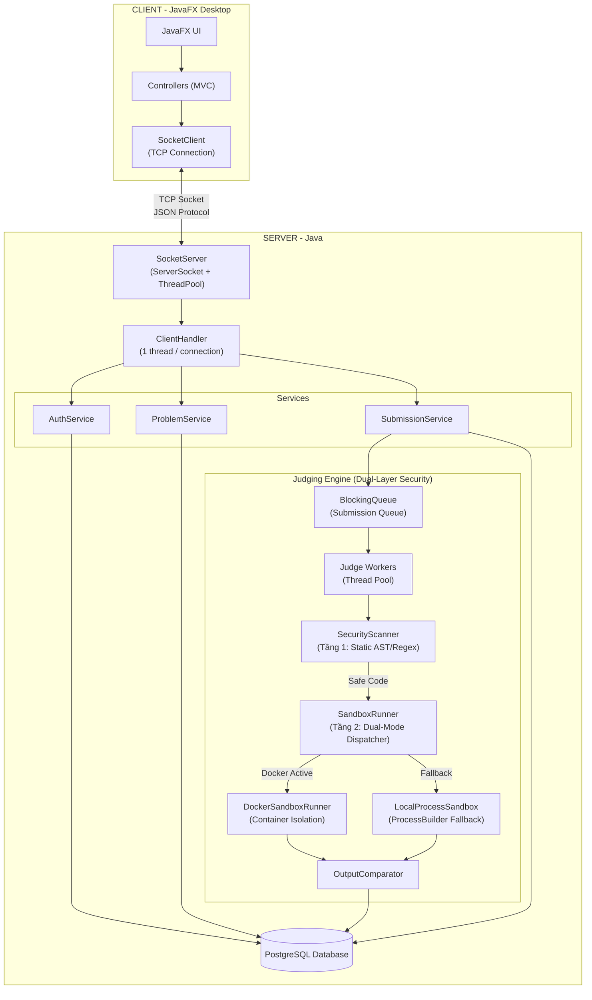
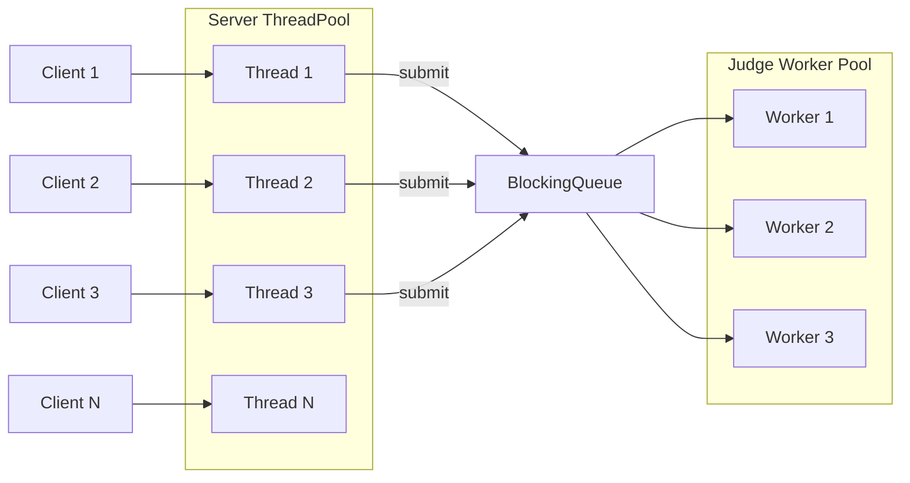
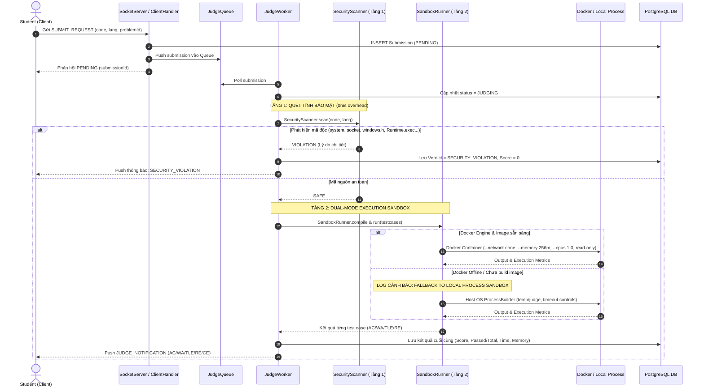
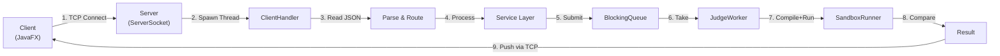

# 🏗️ Kiến Trúc Hệ Thống Chấm Code Tự Động — BTL Lập Trình Mạng

> Thiết kế theo yêu cầu đề bài: **Topic 4.5 – Networked Auto-Grader**

---

## 1. Phân Tích Yêu Cầu Đề Bài

Từ [Instruction.md](file:///c:/Users/Admin/coding-2nd/nam%204%20-%20ki%202/LTM/btl/test_code_grading_server/final-project/Instruction.md) và [Topics.md](file:///c:/Users/Admin/coding-2nd/nam%204%20-%20ki%202/LTM/btl/test_code_grading_server/final-project/Topics.md), các yêu cầu **bắt buộc** gồm:

| # | Yêu cầu | Phần đáp ứng |
|---|---------|--------------|
| 1 | System Architecture | Sơ đồ Client → Server → Queue → Worker |
| 2 | Network Communication (TCP Socket) | Custom protocol qua TCP |
| 3 | Protocol / Message Format | JSON messages qua socket |
| 4 | Concurrency | Thread Pool + Worker Queue |
| 5 | Error Handling | Timeout, disconnect, invalid data... |
| 6 | Novelty & Contributions | Queue + Worker Pool vs baseline tuần tự |
| 7 | Experiment & Evaluation | Đo concurrent submissions, queue time, throughput |
| 8 | Báo cáo dạng technical paper | Theo cấu trúc 8.1–8.19 |

> [!IMPORTANT]
> Thầy nhấn mạnh: *"Một project chỉ có giao diện và database nhưng không thể hiện rõ bản chất của network programming sẽ không được xem là đáp ứng đầy đủ yêu cầu."* → Phải tập trung vào **TCP Socket, protocol design, concurrency**.

---

## 2. System Architecture



### Giải thích các component:

| Component | Trách nhiệm |
|-----------|-------------|
| **JavaFX Client** | Giao diện, chọn ngôn ngữ (C, C++, Java, Python), gửi code, xem kết quả real-time |
| **SocketServer** | Lắng nghe TCP connections, tạo thread xử lý |
| **ClientHandler** | Đọc/ghi message JSON qua socket, routing đến service |
| **AuthService** | Đăng nhập, đăng ký, xác thực JWT |
| **ProblemService** | CRUD bài tập, test cases |
| **SubmissionService** | Nhận bài nộp, đẩy vào queue |
| **BlockingQueue** | Hàng đợi submission chờ chấm |
| **Judge Workers** | Pool các thread chấm bài song song |
| **SecurityScanner** | **Tầng 1 Bảo Mật**: Quét tĩnh AST/Regex chặn shell, network, syscall nguy hiểm |
| **SandboxRunner** | Điều phối Dual-Mode: Docker Container hoặc Fallback sang Local Process Sandbox |
| **DockerSandboxRunner** | **Tầng 2 Bảo Mật**: Container độc lập cô lập tài nguyên (`--network none`, `--memory 256m`) |
| **OutputComparator** | So sánh output thực tế vs expected |
| **PostgreSQL** | Lưu users, problems, test_cases, submissions (hỗ trợ `SECURITY_VIOLATION`) |

---

## 3. Network Communication Design

> [!NOTE]
> Đây là **phần quan trọng nhất** của BTL Lập trình mạng. Thầy sẽ hỏi kỹ phần này.

### 3.1. Communication Model

```text
Client ←——— TCP Socket (persistent connection) ———→ Server
```

- **Protocol**: TCP (đảm bảo tin cậy, thứ tự)
- **Connection**: Persistent — client giữ kết nối suốt phiên làm việc
- **Format**: JSON messages, mỗi message kết thúc bằng `\n` (newline delimiter)
- **Encoding**: UTF-8

### 3.2. Message Framing

Vì TCP là stream-based, cần cơ chế phân tách message:

```text
┌──────────────────────────────────────┐
│  JSON message (1 dòng, không xuống  │
│  hàng bên trong) + ký tự '\n'       │
└──────────────────────────────────────┘
```

**Đọc message**: Dùng `BufferedReader.readLine()` — đọc đến khi gặp `\n`

**Ghi message**: Dùng `PrintWriter.println(jsonString)` — tự thêm `\n`

### 3.3. Protocol / Message Format

#### Request Format:
```json
{
  "type": "LOGIN",
  "requestId": "req-001",
  "token": null,
  "data": {
    "username": "student01",
    "password": "123456"
  }
}
```

#### Response Format:
```json
{
  "type": "LOGIN_RESPONSE",
  "requestId": "req-001",
  "status": "SUCCESS",
  "message": "Login successful",
  "data": {
    "token": "jwt-token-here",
    "userId": 1,
    "role": "STUDENT"
  }
}
```

#### Error Response:
```json
{
  "type": "ERROR",
  "requestId": "req-001",
  "status": "FAIL",
  "message": "Invalid username or password",
  "data": null
}
```

### 3.4. Danh Sách Message Types

| Type | Direction | Mô tả |
|------|-----------|--------|
| `LOGIN` | Client → Server | Đăng nhập |
| `REGISTER` | Client → Server | Đăng ký |
| `LOGIN_RESPONSE` | Server → Client | Kết quả đăng nhập |
| `REGISTER_RESPONSE` | Server → Client | Kết quả đăng ký |
| `GET_PROBLEMS` | Client → Server | Lấy danh sách bài |
| `GET_PROBLEMS_RESPONSE` | Server → Client | Trả danh sách bài |
| `GET_PROBLEM_DETAIL` | Client → Server | Xem chi tiết 1 bài |
| `GET_PROBLEM_DETAIL_RESPONSE` | Server → Client | Trả chi tiết bài |
| `SUBMIT` | Client → Server | Nộp code |
| `SUBMIT_RESPONSE` | Server → Client | Xác nhận nhận bài (PENDING) |
| `GET_RESULT` | Client → Server | Hỏi kết quả chấm |
| `GET_RESULT_RESPONSE` | Server → Client | Trả kết quả chấm |
| `GET_HISTORY` | Client → Server | Xem lịch sử nộp bài |
| `GET_HISTORY_RESPONSE` | Server → Client | Trả lịch sử |
| `JUDGE_NOTIFICATION` | Server → Client | Push kết quả khi chấm xong |
| `ERROR` | Server → Client | Lỗi chung |

### 3.5. Communication Sequence

```text
Client                                          Server
  |                                                |
  |---------- [TCP Connect] ---------------------->|  (1) Mở kết nối
  |                                                |
  |---------- LOGIN {user, pass} ----------------->|  (2) Gửi đăng nhập
  |<--------- LOGIN_RESPONSE {token} --------------|  (3) Trả JWT token
  |                                                |
  |---------- GET_PROBLEMS {token} --------------->|  (4) Yêu cầu DS bài
  |<--------- GET_PROBLEMS_RESPONSE {list} --------|  (5) Trả DS bài
  |                                                |
  |---------- SUBMIT {token, code, lang} --------->|  (6) Nộp bài
  |<--------- SUBMIT_RESPONSE {id, PENDING} -------|  (7) Xác nhận đã nhận
  |                                                |
  |           ... Server chấm bài trong queue ...  |
  |                                                |
  |<--------- JUDGE_NOTIFICATION {id, AC, 100} ----|  (8) Push kết quả
  |                                                |
  |---------- GET_HISTORY {token} ---------------->|  (9) Xem lịch sử
  |<--------- GET_HISTORY_RESPONSE {list} ---------|  (10) Trả lịch sử
  |                                                |
  |---------- [TCP Close] ----------------------->|  (11) Đóng kết nối
```

### 3.6. Cách Đóng Connection

- **Client chủ động**: Gửi message `DISCONNECT`, sau đó đóng socket
- **Server phát hiện disconnect**: `readLine()` trả `null` → cleanup ClientHandler
- **Timeout**: Server đóng connection nếu client không hoạt động > 5 phút

---

## 4. Concurrency Design

> [!IMPORTANT]
> Thầy yêu cầu rõ: Thread per connection, Thread pool, Worker queue, Shared state synchronization.

### 4.1. Mô hình xử lý đồng thời



### 4.2. Chi tiết

| Thành phần | Cơ chế | Giải thích |
|---|---|---|
| **Connection Pool** | `ExecutorService.newFixedThreadPool(20)` | Tối đa 20 client đồng thời |
| **ClientHandler** | 1 thread / connection | Mỗi client có thread riêng đọc/ghi |
| **Submission Queue** | `LinkedBlockingQueue<Submission>` | Thread-safe, blocking khi empty |
| **Judge Workers** | `ExecutorService.newFixedThreadPool(4)` | 4 worker chấm song song |
| **Shared State** | `ConcurrentHashMap<Integer, Socket>` | Map userId → socket cho push notification |
| **DB Connection** | Connection Pool (HikariCP hoặc tự quản lý) | Thread-safe PostgreSQL access |

### 4.3. Vấn đề đồng thời cần xử lý

1. **Race condition**: 2 thread cùng ghi DB → dùng synchronized / transaction
2. **Deadlock**: Tránh lock lồng nhau
3. **Queue overflow**: Giới hạn queue size, reject khi đầy
4. **Client disconnect khi đang chấm**: Worker vẫn chấm xong, lưu DB, client kết nối lại xem kết quả

### 4.4. Kiến Trúc Bảo Mật 2 Tầng & Đa Ngôn Ngữ (Production Sandbox Engine)

Hệ thống hỗ trợ 4 ngôn ngữ lập trình chuẩn: **C (`gcc`), C++ (`g++`), Python (`python3`), Java (`javac`/`java`)** với thiết kế phòng thủ chiều sâu (Defense-in-Depth):



#### Bảng so sánh 2 Tầng Bảo Mật:

| Đặc tính | Tầng 1: SecurityScanner (Static) | Tầng 2: Docker Sandbox (Dynamic) | Tầng 2 Fallback: Local Process |
|---|---|---|---|
| **Thời điểm kích hoạt** | Trước khi biên dịch (0 ms overhead) | Trong quá trình biên dịch & chạy | Khi Docker không khả dụng |
| **Cơ chế thực thi** | Phân tích từ khóa/AST Regex | Cô lập nhân Linux Container | ProcessBuilder trên Host OS |
| **Mạng (Network)** | Chặn cú pháp Socket, HTTP, curl | `--network none` (Cắt 100% mạng) | Được bảo vệ bởi Tầng 1 |
| **Tài nguyên (RAM/CPU)** | Không tiêu tốn tài nguyên | `--memory 256m`, `--cpus 1.0` | Giới hạn Timeout tiến trình |
| **Filesystem** | Chặn đọc file hệ điều hành | Read-Only Mount (`/app:ro`) | Thư mục riêng `./temp/judge/<id>` |
| **Logging** | Ghi log lý do vi phạm | Ghi log container id & mode | Ghi log cảnh báo `⚠️ [LOCAL_SANDBOX]` to rõ |

---

## 5. Error Handling

| Tình huống | Xử lý |
|---|---|
| **Invalid JSON** | Server gửi ERROR response, không crash |
| **Invalid token** | Trả `UNAUTHORIZED`, yêu cầu login lại |
| **Client disconnect** | Server dọn dẹp thread, log sự kiện |
| **Server unavailable** | Client hiện dialog "Không kết nối được", cho retry |
| **Security Attack** | `SecurityScanner` chặn đứng, verdict `SECURITY_VIOLATION`, 0 điểm |
| **Timeout (chấm bài)** | `Process.waitFor(timeout)` → kill process, trả TLE |
| **Compile Error** | Trả CE + compiler output cho client |
| **Runtime Error** | Bắt exit code != 0, trả RE |
| **Database error** | Catch SQLException, trả ERROR response |
| **Duplicate submission** | Cho phép nộp lại, tạo submission mới |
| **Queue đầy** | Trả ERROR "Server busy, try again later" |

---

## 6. Database Schema

```sql
CREATE DATABASE code_grading;
\c code_grading;

-- Custom ENUM types
CREATE TYPE user_role AS ENUM ('STUDENT', 'TEACHER');
CREATE TYPE difficulty_level AS ENUM ('EASY', 'MEDIUM', 'HARD');
CREATE TYPE verdict_type AS ENUM ('PENDING', 'JUDGING', 'AC', 'WA', 'TLE', 'RE', 'CE', 'SECURITY_VIOLATION');

CREATE TABLE users (
    id SERIAL PRIMARY KEY,
    username VARCHAR(50) UNIQUE NOT NULL,
    password_hash VARCHAR(255) NOT NULL,
    full_name VARCHAR(100),
    role user_role DEFAULT 'STUDENT',
    created_at TIMESTAMP DEFAULT CURRENT_TIMESTAMP
);

CREATE TABLE problems (
    id SERIAL PRIMARY KEY,
    title VARCHAR(200) NOT NULL,
    description TEXT NOT NULL,
    time_limit_ms INT DEFAULT 2000,
    memory_limit_kb INT DEFAULT 262144,
    difficulty difficulty_level DEFAULT 'MEDIUM',
    created_by INT,
    created_at TIMESTAMP DEFAULT CURRENT_TIMESTAMP,
    FOREIGN KEY (created_by) REFERENCES users(id)
);

CREATE TABLE test_cases (
    id SERIAL PRIMARY KEY,
    problem_id INT NOT NULL,
    input_data TEXT NOT NULL,
    expected_output TEXT NOT NULL,
    is_sample BOOLEAN DEFAULT FALSE,
    order_num INT DEFAULT 0,
    FOREIGN KEY (problem_id) REFERENCES problems(id)
);

CREATE TABLE submissions (
    id SERIAL PRIMARY KEY,
    user_id INT NOT NULL,
    problem_id INT NOT NULL,
    source_code TEXT NOT NULL,
    language VARCHAR(20) NOT NULL,
    verdict verdict_type DEFAULT 'PENDING',
    score INT DEFAULT 0,
    passed_tests INT DEFAULT 0,
    total_tests INT DEFAULT 0,
    exec_time_ms INT DEFAULT 0,
    memory_used_kb INT DEFAULT 0,
    compile_output TEXT,
    submitted_at TIMESTAMP DEFAULT CURRENT_TIMESTAMP,
    judged_at TIMESTAMP NULL,
    FOREIGN KEY (user_id) REFERENCES users(id),
    FOREIGN KEY (problem_id) REFERENCES problems(id)
);
```

---

## 7. Novelty & Contributions (Điểm mới)

> [!TIP]
> Thầy yêu cầu mỗi project **bắt buộc phải có phần Novelty**. Dưới đây là đề xuất:

### Baseline (cách tiếp cận thông thường):
Hệ thống chấm bài **tuần tự** — server nhận submission, chấm xong mới nhận submission tiếp.

### Proposed (cải tiến):
Hệ thống chấm bài **song song** với **Queue + Worker Pool + Push Notification**:

| Aspect | Baseline (tuần tự) | Proposed (Queue + Workers) |
|--------|-------------------|---------------------------|
| **Chấm bài** | Tuần tự, 1 lúc 1 bài | Song song, N workers |
| **Khi nhiều client submit** | Client phải chờ lần lượt | Đẩy vào queue, chấm đồng thời |
| **Thông báo kết quả** | Client phải poll liên tục | Server push notification qua TCP |
| **Throughput** | Thấp (1 submission/time) | Cao (N submissions/time) |
| **Response time** | Tăng tuyến tính theo queue | Ổn định nhờ parallel |

### Contributions cụ thể:

| # | Contribution | Evidence |
|---|-------------|----------|
| 1 | Queue-based submission processing thay vì tuần tự | So sánh throughput baseline vs proposed |
| 2 | Worker Pool cho parallel judging | Đo thời gian chấm 50 submissions |
| 3 | Server push notification qua TCP persistent connection | Không cần client polling |
| 4 | Custom JSON protocol trên TCP | Thiết kế protocol riêng cho bài toán |

---

## 8. Experiment Plan

Theo yêu cầu đề bài (mục 9 - Online Judge), cần đo:

### 8.1. Kịch bản thực nghiệm

| Scenario | Mô tả | Metric |
|----------|--------|--------|
| **S1** | 1 client, 10 submissions liên tiếp | Queue waiting time, total time |
| **S2** | 5 clients đồng thời, mỗi client 10 submissions | Throughput, avg response time |
| **S3** | 10 clients đồng thời, mỗi client 10 submissions | Throughput, worker utilization |
| **S4** | Baseline (1 worker) vs Proposed (4 workers) | So sánh throughput |

### 8.2. Metrics

| Metric | Cách đo |
|--------|---------|
| **Queue waiting time** | `startJudge - submitTime` |
| **Compilation time** | Đo thời gian compile |
| **Execution time** | Đo thời gian chạy mỗi test |
| **Total judging time** | `judgedAt - submittedAt` |
| **Throughput** | Số submissions chấm xong / phút |
| **Worker utilization** | % thời gian worker busy |
| **Concurrent submissions** | Số submissions trong queue tại 1 thời điểm |

---

## 9. Technology Stack

| Category | Technology | Lý do |
|----------|-----------|-------|
| **Language** | Java 21 | Yêu cầu đề bài, hỗ trợ socket tốt |
| **Client UI** | JavaFX 21 + FXML | Desktop app theo yêu cầu |
| **Network** | TCP Socket (`java.net.Socket`) | **Core của môn LTM** |
| **Protocol** | Custom JSON over TCP | Tự thiết kế protocol |
| **Concurrency** | `ExecutorService`, `BlockingQueue` | Thread pool + worker queue |
| **Database** | PostgreSQL 16 | JDBC — mạnh mẽ, hỗ trợ MVCC tốt |
| **DB Access** | JDBC (java.sql) | Không dùng ORM để thể hiện kiến thức |
| **JSON** | Gson 2.10 | Parse/serialize JSON |
| **Auth** | JWT (jjwt) | Token-based authentication |
| **Build** | Maven | Quản lý dependency |
| **Code Editor** | RichTextFX (optional) | Syntax highlighting |

---

## 10. Cấu Trúc Thư Mục (Theo format thầy)

```text
code-grading-system/
│
├── README.md                    # Theo template thầy cho
├── INSTRUCTION.md               # Copy từ đề
├── TOPICS.md                    # Copy từ đề
│
├── report/
│   └── report.pdf               # Báo cáo dạng paper
│
├── statics/
│   ├── architecture.png         # Sơ đồ kiến trúc
│   ├── protocol.png             # Sơ đồ protocol
│   ├── results/                 # Screenshots, charts
│   └── dataset/                 # Test data cho experiment
│
├── client/                      # REPO 1 — JavaFX Client (Maven project)
│   ├── pom.xml
│   └── src/main/java/com/grading/client/
│       ├── ClientApp.java               # Entry point
│       ├── controller/                  # FXML Controllers
│       │   ├── LoginController.java
│       │   ├── DashboardController.java
│       │   ├── ProblemController.java
│       │   ├── SubmitController.java
│       │   └── ResultController.java
│       ├── model/                       # Data models
│       │   ├── User.java
│       │   ├── Problem.java
│       │   ├── Submission.java
│       │   └── TestResult.java
│       ├── network/                     # Network layer
│       │   ├── SocketClient.java        # TCP connection
│       │   ├── MessageSender.java       # Gửi JSON message
│       │   └── MessageListener.java     # Nhận & dispatch message
│       └── protocol/                    # Protocol (copy riêng)
│           ├── Message.java             # Base message class
│           ├── MessageType.java         # Enum message types
│           ├── Request.java
│           └── Response.java
│
└── server/                      # REPO 2 — Java Server (Maven project)
    ├── pom.xml
    └── src/main/java/com/grading/server/
        ├── ServerApp.java               # Entry point
        ├── network/                     # Network layer
        │   ├── SocketServer.java        # ServerSocket + accept
        │   └── ClientHandler.java       # Thread xử lý 1 client
        ├── service/                     # Business logic
        │   ├── AuthService.java
        │   ├── ProblemService.java
        │   └── SubmissionService.java
        ├── judge/                       # Judging engine
        │   ├── JudgeQueue.java          # BlockingQueue wrapper
        │   ├── JudgeWorker.java         # Worker thread
        │   ├── SandboxRunner.java       # Compile & run code
        │   └── OutputComparator.java
        ├── repository/                  # Database access
        │   ├── UserRepository.java
        │   ├── ProblemRepository.java
        │   └── SubmissionRepository.java
        └── protocol/                    # Protocol (copy riêng)
            ├── Message.java             # Base message class
            ├── MessageType.java         # Enum message types
            ├── Request.java
            └── Response.java
```

---

## 11. Tóm Tắt — Bản Chất Network Programming



**4 câu hỏi thầy sẽ hỏi (mục 19 Instruction):**

| Câu hỏi | Trả lời |
|----------|---------|
| **Bài toán là gì?** | Hệ thống chấm code tự động qua mạng |
| **Hệ thống giải quyết thế nào?** | Client gửi code qua TCP → Server queue → Workers chấm song song → Push kết quả |
| **Điểm cải tiến?** | Queue + Worker Pool thay vì tuần tự, push notification thay vì polling |
| **Bằng chứng thực nghiệm?** | So sánh throughput/response time baseline vs proposed với N clients |
