# 📋 Phân Công Công Việc — Nhóm 3 Người

> Dự án: **Hệ Thống Chấm Code Tự Động (Networked Auto-Grader)**
> Tham chiếu: [architecture.md](file:///c:/Users/Admin/coding-2nd/nam%204%20-%20ki%202/LTM/btl/test_code_grading_server/final-project/architecture.md)

---

## 🔑 Nguyên Tắc Làm Song Song

```text
                    ┌──────────────────┐
                    │  PROTOCOL SPEC   │ ← Thống nhất TRƯỚC khi code
                    │  (Message format │
                    │   & data schema) │
                    └───┬────┬────┬────┘
                        │    │    │
              ┌─────────▼┐ ┌▼────▼──────┐
              │ Client A │ │  Server B  │
              │          │ │            │
              │ mock JSON│ │ mock judge │───→ │ Judge C │
              │ response │ │ (trả AC)   │     │         │
              └──────────┘ └────────────┘     └─────────┘
```

- **A** mock server → làm UI mà không cần chờ B
- **B** mock judge → làm network + service mà không cần chờ C
- **C** viết judge độc lập → nhận input trả output, không cần socket

---

## 👤 Thành Viên A — Client (JavaFX)

**Repo**: `client/`
**Package**: `com.grading.client`

### Danh sách task:

| # | Task | File(s) | Ưu tiên | Trạng thái |
|---|------|---------|---------|------------|
| A1 | Setup Maven project + dependencies (JavaFX, Gson, jjwt) | `pom.xml` | 🔴 Cao | ⬜ |
| A2 | Tạo protocol classes (copy từ spec chung) | `protocol/Message.java`, `MessageType.java`, `Request.java`, `Response.java` | 🔴 Cao | ⬜ |
| A3 | Viết `SocketClient` — kết nối TCP đến server | `network/SocketClient.java` | 🔴 Cao | ⬜ |
| A4 | Viết `MessageSender` — serialize & gửi JSON qua socket | `network/MessageSender.java` | 🔴 Cao | ⬜ |
| A5 | Viết `MessageListener` — thread lắng nghe & dispatch response | `network/MessageListener.java` | 🔴 Cao | ⬜ |
| A6 | Màn hình Login + `LoginController` | `controller/LoginController.java` + FXML | 🟡 TB | ⬜ |
| A7 | Màn hình Dashboard (danh sách bài) + `DashboardController` | `controller/DashboardController.java` + FXML | 🟡 TB | ⬜ |
| A8 | Màn hình xem bài + nộp code + `ProblemController` | `controller/ProblemController.java` + FXML | 🟡 TB | ⬜ |
| A9 | Màn hình Submit + `SubmitController` | `controller/SubmitController.java` + FXML | 🟡 TB | ⬜ |
| A10 | Màn hình kết quả + lịch sử + `ResultController` | `controller/ResultController.java` + FXML | 🟡 TB | ⬜ |
| A11 | Data models (dùng trong UI) | `model/User.java`, `Problem.java`, `Submission.java`, `TestResult.java` | 🟢 Thấp | ⬜ |
| A12 | Xử lý JUDGE_NOTIFICATION (nhận push từ server) | `MessageListener.java` | 🟢 Thấp | ⬜ |
| A13 | Error handling UI (mất kết nối, timeout, invalid input) | Các controller | 🟢 Thấp | ⬜ |

### Mock để test riêng:

```java
// MockServer.java — A tự tạo để test UI
// Mở ServerSocket, nhận request, trả hardcode JSON response
ServerSocket server = new ServerSocket(9999);
Socket client = server.accept();
BufferedReader in = new BufferedReader(new InputStreamReader(client.getInputStream()));
PrintWriter out = new PrintWriter(client.getOutputStream(), true);

String request = in.readLine();
// Luôn trả login thành công
out.println("{\"type\":\"LOGIN_RESPONSE\",\"requestId\":\"req-001\",\"status\":\"SUCCESS\",\"data\":{\"token\":\"fake-token\",\"userId\":1,\"role\":\"STUDENT\"}}");
```

---

## 👤 Thành Viên B — Server Core (Network + Services + DB)

**Repo**: `server/`
**Package**: `com.grading.server`

### Danh sách task:

| # | Task | File(s) | Ưu tiên | Trạng thái |
|---|------|---------|---------|------------|
| B1 | Setup Maven project + dependencies (Gson, PostgreSQL JDBC, jjwt, HikariCP) | `pom.xml` | 🔴 Cao | ⬜ |
| B2 | Tạo protocol classes (copy từ spec chung) | `protocol/Message.java`, `MessageType.java`, `Request.java`, `Response.java` | 🔴 Cao | ⬜ |
| B3 | Tạo database PostgreSQL + chạy schema SQL | Schema từ `architecture.md` mục 6 | 🔴 Cao | ⬜ |
| B4 | Viết `SocketServer` — ServerSocket + ThreadPool accept connections | `network/SocketServer.java` | 🔴 Cao | ⬜ |
| B5 | Viết `ClientHandler` — đọc JSON, routing đến service | `network/ClientHandler.java` | 🔴 Cao | ⬜ |
| B6 | Viết `UserRepository` — JDBC CRUD cho bảng `users` | `repository/UserRepository.java` | 🔴 Cao | ⬜ |
| B7 | Viết `AuthService` — đăng nhập, đăng ký, hash password, tạo JWT | `service/AuthService.java` | 🔴 Cao | ⬜ |
| B8 | Viết `ProblemRepository` — JDBC CRUD cho bảng `problems` + `test_cases` | `repository/ProblemRepository.java` | 🟡 TB | ⬜ |
| B9 | Viết `ProblemService` — lấy danh sách bài, chi tiết bài | `service/ProblemService.java` | 🟡 TB | ⬜ |
| B10 | Viết `SubmissionRepository` — JDBC CRUD cho bảng `submissions` | `repository/SubmissionRepository.java` | 🟡 TB | ⬜ |
| B11 | Viết `SubmissionService` — nhận bài nộp, đẩy vào queue, lưu DB | `service/SubmissionService.java` | 🟡 TB | ⬜ |
| B12 | Quản lý active connections — `ConcurrentHashMap<userId, Socket>` cho push | `network/ClientHandler.java` | 🟡 TB | ⬜ |
| B13 | Seed data — thêm bài tập mẫu + test cases vào DB | SQL script | 🟢 Thấp | ⬜ |
| B14 | Socket timeout + xử lý disconnect | `ClientHandler.java` | 🟢 Thấp | ⬜ |

### Mock để test riêng:

```java
// Khi client submit bài, thay vì đẩy vào JudgeQueue thật:
// Mock: luôn trả ACCEPTED sau 2 giây
new Thread(() -> {
    Thread.sleep(2000);
    submission.setVerdict("AC");
    submission.setScore(100);
    submissionRepo.update(submission);
    // Push notification cho client
    pushResult(submission);
}).start();
```

---

## 👤 Thành Viên C — Judge Engine + Experiment

**Repo**: `server/` (package `judge/`)
**Package**: `com.grading.server.judge`

### Danh sách task:

| # | Task | File(s) | Ưu tiên | Trạng thái |
|---|------|---------|---------|------------|
| C1 | Viết `SandboxRunner` — compile code (javac / gcc) bằng `ProcessBuilder` | `judge/SandboxRunner.java` | 🔴 Cao | ⬜ |
| C2 | Viết `SandboxRunner` — chạy code với stdin, bắt stdout | `judge/SandboxRunner.java` | 🔴 Cao | ⬜ |
| C3 | Xử lý timeout — `Process.waitFor(timeout)` → kill → trả TLE | `judge/SandboxRunner.java` | 🔴 Cao | ⬜ |
| C4 | Xử lý Compile Error — bắt stderr từ compiler → trả CE | `judge/SandboxRunner.java` | 🔴 Cao | ⬜ |
| C5 | Xử lý Runtime Error — exit code != 0 → trả RE | `judge/SandboxRunner.java` | 🔴 Cao | ⬜ |
| C6 | Viết `OutputComparator` — so sánh output thực tế vs expected | `judge/OutputComparator.java` | 🟡 TB | ⬜ |
| C7 | Viết `JudgeQueue` — wrapper cho `LinkedBlockingQueue` | `judge/JudgeQueue.java` | 🟡 TB | ⬜ |
| C8 | Viết `JudgeWorker` — thread lấy từ queue, gọi SandboxRunner, cập nhật kết quả | `judge/JudgeWorker.java` | 🟡 TB | ⬜ |
| C9 | Tính điểm — `passed_tests / total_tests * 100` | `judge/JudgeWorker.java` | 🟡 TB | ⬜ |
| C10 | Đo `exec_time_ms` và `memory_used_kb` cho mỗi submission | `judge/SandboxRunner.java` | 🟢 Thấp | ⬜ |
| C11 | Viết experiment script — chạy kịch bản S1–S4 | Experiment script | 🟢 Thấp | ⬜ |
| C12 | Thu thập metrics — queue time, throughput, worker utilization | Experiment script | 🟢 Thấp | ⬜ |
| C13 | Tạo bảng/biểu đồ so sánh baseline vs proposed | Báo cáo | 🟢 Thấp | ⬜ |

### Test riêng (không cần socket):

```java
// C test trực tiếp SandboxRunner mà không cần server:
SandboxRunner runner = new SandboxRunner();

// Compile
CompileResult cr = runner.compile("Main.java", sourceCode, "java");
if (!cr.isSuccess()) {
    System.out.println("CE: " + cr.getError());
    return;
}

// Run với test case
RunResult rr = runner.run("Main", "3 5\n", 2000); // input, timeout
System.out.println("Output: " + rr.getStdout());   // "8\n"
System.out.println("Time: " + rr.getTimeMs());      // 45
```

---

## 🤝 Phần Chung — Cả 3 Cùng Làm

| # | Task | Ai lead | Deadline |
|---|------|---------|----------|
| S1 | Thống nhất protocol: message format + data schema cho MỌI message type | Cả 3 | **Ngày đầu tiên** |
| S2 | Tích hợp Client ↔ Server | A + B | Tuần 3 |
| S3 | Tích hợp Server ↔ Judge | B + C | Tuần 3 |
| S4 | Test end-to-end (nộp bài → nhận kết quả) | Cả 3 | Tuần 3 |
| S5 | Viết báo cáo (technical paper) | Cả 3 chia section | Tuần 3–4 |
| S6 | Chuẩn bị demo + trả lời câu hỏi thầy | Cả 3 | Tuần 4 |

---

## 📅 Timeline Tổng Quan

```text
Tuần 1  ━━━━━━━━━━━━━━━━━━━━━━━━━━━━━━━━━━━━━━━━━━━━━━
        🤝 Ngày 1: Cả 3 họp thống nhất protocol (S1)
        
        A: Setup project ──→ SocketClient ──→ Login UI
        B: Setup project ──→ DB schema ──→ SocketServer ──→ AuthService
        C: SandboxRunner (compile + run + timeout)

Tuần 2  ━━━━━━━━━━━━━━━━━━━━━━━━━━━━━━━━━━━━━━━━━━━━━━
        A: Dashboard UI ──→ Submit UI ──→ Result UI
        B: ClientHandler routing ──→ ProblemService ──→ SubmissionService
        C: OutputComparator ──→ JudgeQueue ──→ JudgeWorker

Tuần 3  ━━━━━━━━━━━━━━━━━━━━━━━━━━━━━━━━━━━━━━━━━━━━━━
        🔗 TÍCH HỢP
        A+B: Ghép Client ↔ Server, fix bugs
        B+C: Ghép Server ↔ Judge, fix bugs
        Cả 3: Test end-to-end

Tuần 4  ━━━━━━━━━━━━━━━━━━━━━━━━━━━━━━━━━━━━━━━━━━━━━━
        C: Chạy experiment S1–S4, thu thập metrics
        Cả 3: Viết báo cáo, chuẩn bị demo
```

---

## ⚠️ Dependency Map — Ai Block Ai?

```mermaid
graph TD
    S1["🤝 S1: Thống nhất Protocol"] --> A2["A: Protocol classes"]
    S1 --> B2["B: Protocol classes"]
    
    A2 --> A3["A: SocketClient"]
    A3 --> A6["A: Login UI"]
    A6 --> A7["A: Dashboard"]
    A7 --> A9["A: Submit"]
    
    B2 --> B4["B: SocketServer"]
    B4 --> B5["B: ClientHandler"]
    B3["B: DB Schema"] --> B6["B: UserRepo"]
    B6 --> B7["B: AuthService"]
    B3 --> B8["B: ProblemRepo"]
    B8 --> B9["B: ProblemService"]
    
    C1["C: SandboxRunner"] --> C6["C: OutputComparator"]
    C6 --> C8["C: JudgeWorker"]
    C7["C: JudgeQueue"] --> C8
    
    A9 --> INT1["🔗 Tích hợp A+B"]
    B5 --> INT1
    
    C8 --> INT2["🔗 Tích hợp B+C"]
    B5 --> INT2
    
    INT1 --> E2E["✅ Test End-to-End"]
    INT2 --> E2E
    
    E2E --> C11["C: Experiment"]
    E2E --> RPT["📝 Báo cáo"]
```



> [!IMPORTANT]
> **Không ai block ai ở tuần 1–2** vì mỗi người tự mock phần của người khác. Chỉ cần gặp nhau ở **tuần 3 để tích hợp**.

---

## 📌 Checklist Trước Khi Tích Hợp

- [ ] A: Client kết nối được MockServer, gửi/nhận JSON đúng format
- [ ] B: Server accept được connection, parse JSON, routing đúng service, trả response
- [ ] C: SandboxRunner compile + run được code Java, trả verdict đúng
- [ ] A + B: Protocol classes **giống hệt nhau** (MessageType enum, field names)
- [ ] B + C: JudgeWorker lấy được submission từ queue, chấm xong cập nhật DB
