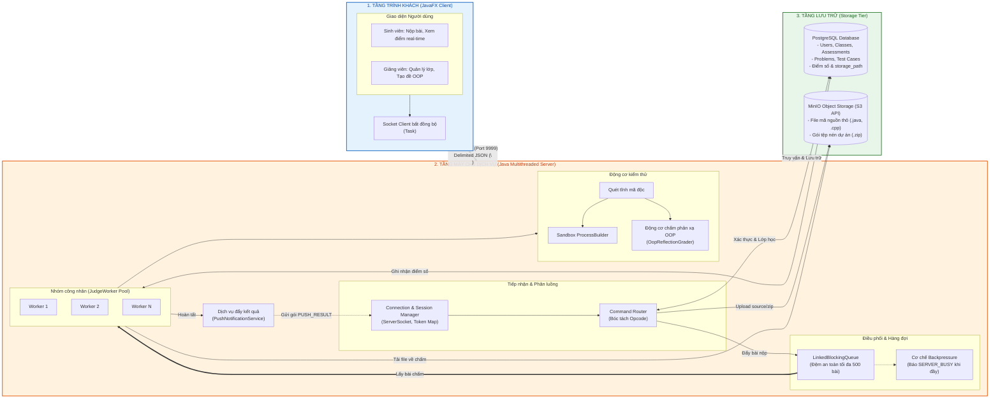

# THIẾT KẾ HÌNH 3.1: SƠ ĐỒ KIẾN TRÚC PHÂN TẦNG TỔNG THỂ HỆ THỐNG
(Bố cục chiều ngang: Client -> Server -> Storage)

---

## 1. MÃ MERMAID CHIỀU NGANG (Vào mermaid.live hoặc Draw.io để xuất ảnh PNG/SVG)



---

## 2. PROMPT DÁN VÀO CHATGPT / CLAUDE / ERASER.IO / NAPKIN AI

```text
Hãy vẽ giúp tôi sơ đồ kiến trúc phân tầng hệ thống (System Architecture Diagram) theo BỐ CỤC CHIỀU NGANG (Left-to-Right layout) cho đề tài "Hệ thống chấm mã nguồn tự động phân tán qua mạng socket TCP".

Bố cục gồm 3 cột chính từ Trái sang Phải:

CỘT 1 (BÊN TRÁI): TẦNG TRÌNH KHÁCH (CLIENT TIER - JavaFX)
- Gồm giao diện Sinh viên (Nộp bài đơn/ZIP, nhận kết quả đẩy tức thì) và Giảng viên (Quản lý lớp, tạo đề bài OOP).
- Bên dưới là khối Socket Client bất đồng bộ (Async Socket Client).

ĐOẠN NỐI GIỮA CỘT 1 VÀ CỘT 2:
- Đường truyền kết nối 2 chiều có nhãn: "Socket TCP (Port 9999) - Giao thức Delimited JSON (\n)".

CỘT 2 (Ở GIỮA - TRỌNG TÂM): TẦNG MÁY CHỦ (SERVER TIER - Java Backend)
Chứa các khối chức năng xử lý nội bộ theo luồng:
- Khối 1: Connection & Session Manager (lắng nghe ServerSocket, quản lý phiên kết nối).
- Khối 2: Command Router (bóc tách opcode, điều hướng tác vụ).
- Khối 3: In-memory Task Queue (LinkedBlockingQueue tối đa 500 bài, có cơ chế Backpressure tự bảo vệ bộ nhớ).
- Khối 4: JudgeWorker Pool (nhóm luồng công nhân song song).
- Khối 5: Phân hệ chấm bài gồm: Bộ quét mã độc tĩnh -> Sandbox ProcessBuilder và Động cơ chấm phản xạ động Java OOP (OopReflectionGrader).
- Khối 6: Dịch vụ thông báo đẩy (Real-time Push Service) kết nối ngược lại Connection Manager để chủ động bắn gói tin PUSH_RESULT về Client.

CỘT 3 (BÊN PHẢI): TẦNG LƯU TRỮ (STORAGE TIER)
Gồm 2 hệ thống lưu trữ độc lập:
- Cơ sở dữ liệu quan hệ PostgreSQL: Quản lý metadata tài khoản, lớp học, đề bài, điểm số và đường dẫn tệp storage_path.
- MinIO Object Storage (chuẩn S3): Lưu trữ mã nguồn thô và các tệp nén ZIP bài làm của sinh viên.

Mũi tên tương tác:
- Server kết nối 2 chiều với PostgreSQL để xác thực và lưu kết quả.
- Server đẩy file lên MinIO và Worker tải file về để chấm.

Yêu cầu hiển thị: Phong cách phẳng hiện đại (Flat/Clean Architecture), các khối viền nét rõ ràng, phân màu trang nhã cho 3 cột (Xanh dương cho Client, Cam nhạt cho Server, Xanh lá cho Storage), nhãn chữ tiếng Việt chuẩn xác.
```
