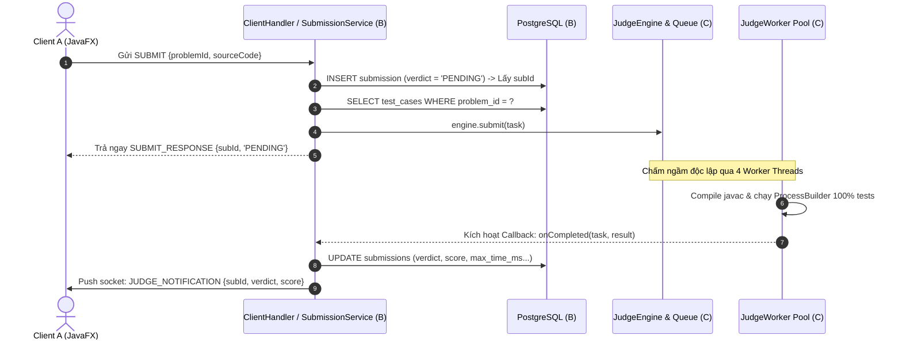

# 📘 Hướng Dẫn Tích Hợp Judge Engine Cho Thành Viên B (Server Core)

> **Dành cho:** Thành viên B — Server Network, Services & Database  
> **Tác giả:** Thành viên C — Judge Engine & Concurrency  
> **Mục đích:** Hướng dẫn kết nối `JudgeEngine` vào `SocketServer`, `SubmissionService` và PostgreSQL mà không cần lo lắng về chi tiết biên dịch/sandbox bên dưới.  
> **Tham chiếu code:** [com.grading.server.judge](file:///d:/26.Ki_7/3.LTM/ltm_code_judge/server/src/main/java/com/grading/server/judge)

---

## 🎯 1. Tổng Quan Kiến Trúc Ghép Nối

`JudgeEngine` hoạt động như một **hộp đen bất đồng bộ (Asynchronous Black-Box)** dựa trên mô hình **Producer-Consumer**:



---

## 📦 2. Các Lớp & Model Thành Viên B Cần Sử Dụng

Thành viên B chỉ cần tương tác với **3 class chính** trong package `com.grading.server.judge`:

### 2.1. `JudgeEngine` — Bộ điều phối chính
- **Khởi tạo**: `JudgeEngine engine = new JudgeEngine(4);` (mặc định 4 workers song song).
- **Vòng đời**:
  - `engine.start()`: Khởi động pool worker threads khi server start.
  - `engine.shutdown()`: Dừng các worker threads an toàn khi server stop.
- **Đẩy bài chấm**: `engine.submit(task);` (non-blocking với Client, đẩy thẳng vào `LinkedBlockingQueue`).
- **Đăng ký callback**: `engine.setOnJudgeCompletedListener((task, result) -> { ... });`

### 2.2. `SubmissionTask` — Đối tượng bài nộp đẩy vào Engine
Nằm tại: `com.grading.server.judge.model.SubmissionTask`
```java
SubmissionTask task = new SubmissionTask(
    submissionId,    // long: ID từ bảng submissions trong PostgreSQL
    problemId,       // int: ID bài toán
    sourceCode,      // String: Mã nguồn Java sinh viên nộp
    testCases,       // List<TestCase>: Danh sách test cases lấy từ DB
    timeLimitMs      // long: Giới hạn thời gian mỗi test (mặc định 1000ms hoặc từ problem)
);
```

### 2.3. `TestCase` — Dữ liệu từng test case
Nằm tại: `com.grading.server.judge.model.TestCase`
```java
new TestCase(id, inputData, expectedOutput);
```

### 2.4. `JudgeResult` — Kết quả chấm trả về trong Callback
Nằm tại: `com.grading.server.judge.model.JudgeResult`
Cung cấp các getter để Thành viên B cập nhật PostgreSQL:
| Getter trong `JudgeResult` | Kiểu dữ liệu | Cột tương ứng trong bảng `submissions` |
| :--- | :--- | :--- |
| `result.getVerdict()` | `VerdictType` | `verdict` (`AC`, `WA`, `TLE`, `RE`, `CE`) |
| `result.getScore()` | `int` (0–100) | `score` |
| `result.getPassedTests()` | `int` | `passed_tests` |
| `result.getTotalTests()` | `int` | `total_tests` |
| `result.getMaxTimeMs()` | `long` | `exec_time_ms` |
| `result.getCompileError()`| `String` | `compile_output` |

---

## 🛠️ 3. Hướng Dẫn Tích Hợp Chi Tiết (Code Mẫu Từng Bước)

### Bước 1: Khởi tạo `JudgeEngine` trong `SocketServer.java`

Thành viên B tạo một instance `JudgeEngine` duy nhất (Singleton hoặc trường thuộc Server), cấu hình Callback toàn cục để:
1. Cập nhật kết quả vào DB.
2. Push notification qua socket cho Client.

```java
package com.grading.server.network;

import com.grading.server.judge.JudgeEngine;
import com.grading.server.judge.model.JudgeResult;
import com.grading.server.judge.model.SubmissionTask;
import com.grading.server.repository.SubmissionRepository;

import java.net.ServerSocket;
import java.net.Socket;
import java.util.concurrent.ConcurrentHashMap;

public class SocketServer {

    private final int port;
    private final JudgeEngine judgeEngine;
    private final SubmissionRepository submissionRepo;
    
    // Map lưu kết nối active để push kết quả: userId -> ClientHandler
    private final ConcurrentHashMap<Integer, ClientHandler> activeClients = new ConcurrentHashMap<>();

    public SocketServer(int port) {
        this.port = port;
        this.submissionRepo = new SubmissionRepository();
        
        // Khởi tạo JudgeEngine với 4 Workers song song
        this.judgeEngine = new JudgeEngine(4);

        // Đăng ký Callback: Tự động chạy mỗi khi có 1 bài chấm xong
        this.judgeEngine.setOnJudgeCompletedListener(this::handleJudgeCompleted);
    }

    public void start() {
        // 1. Khởi động Judge Engine
        judgeEngine.start();
        System.out.println("✅ JudgeEngine đã khởi động 4 workers sẵn sàng chấm bài.");

        // 2. Mở ServerSocket lắng nghe Client
        try (ServerSocket serverSocket = new ServerSocket(port)) {
            System.out.println("🚀 Server đang lắng nghe tại port: " + port);
            while (true) {
                Socket clientSocket = serverSocket.accept();
                ClientHandler handler = new ClientHandler(clientSocket, this, judgeEngine);
                new Thread(handler).start();
            }
        } catch (Exception e) {
            e.printStackTrace();
        } finally {
            stop();
        }
    }

    private void handleJudgeCompleted(SubmissionTask task, JudgeResult result) {
        long subId = task.getSubmissionId();
        System.out.printf("🔔 [JUDGE DONE] Bài #%d -> Verdict: %s | Điểm: %d%n", subId, result.getVerdict(), result.getScore());

        // 1. Cập nhật kết quả vào PostgreSQL
        submissionRepo.updateResult(
            subId,
            result.getVerdict().name(),
            result.getScore(),
            result.getPassedTests(),
            result.getTotalTests(),
            (int) result.getMaxTimeMs(),
            result.getCompileError()
        );

        // 2. Tìm userId từ DB để push notification qua socket cho Client A
        int userId = submissionRepo.getUserIdBySubmissionId(subId);
        ClientHandler client = activeClients.get(userId);
        if (client != null) {
            client.pushJudgeNotification(subId, result);
        }
    }

    public void stop() {
        // Tắt an toàn Judge Engine khi dừng Server
        judgeEngine.shutdown();
        System.out.println("🛑 JudgeEngine đã dừng an toàn.");
    }
}
```

---

### Bước 2: Xử lý Request `SUBMIT` trong `SubmissionService.java`

Khi nhận bản tin `SUBMIT` từ Client:

```java
package com.grading.server.service;

import com.grading.server.judge.JudgeEngine;
import com.grading.server.judge.model.SubmissionTask;
import com.grading.server.judge.model.TestCase;
import com.grading.server.repository.ProblemRepository;
import com.grading.server.repository.SubmissionRepository;

import java.util.List;

public class SubmissionService {

    private final JudgeEngine judgeEngine;
    private final SubmissionRepository submissionRepo;
    private final ProblemRepository problemRepo;

    public SubmissionService(JudgeEngine judgeEngine, SubmissionRepository submissionRepo, ProblemRepository problemRepo) {
        this.judgeEngine = judgeEngine;
        this.submissionRepo = submissionRepo;
        this.problemRepo = problemRepo;
    }

    public long handleSubmit(int userId, int problemId, String sourceCode) throws Exception {
        // 1. Lưu bản ghi nộp bài vào PostgreSQL với trạng thái ban đầu là PENDING
        long submissionId = submissionRepo.createSubmission(userId, problemId, sourceCode, "JAVA");

        // 2. Lấy danh sách test cases và time limit của bài từ DB
        List<TestCase> testCases = problemRepo.getTestCasesByProblemId(problemId);
        long timeLimitMs = problemRepo.getTimeLimitMs(problemId); // Thường là 1000ms hoặc 2000ms

        // 3. Đóng gói SubmissionTask và đẩy vào Judge Engine
        SubmissionTask task = new SubmissionTask(
            submissionId,
            problemId,
            sourceCode,
            testCases,
            timeLimitMs
        );

        // Đẩy vào BlockingQueue (cực nhanh, không làm nghẽn luồng Socket của Client)
        judgeEngine.submit(task);

        // 4. Trả ngay ID về cho ClientHandler gửi phản hồi SUBMIT_RESPONSE
        return submissionId;
    }
}
```

---

### Bước 3: Push Notification về Client A qua TCP Socket

Khi worker chấm xong, `ClientHandler` đẩy bản tin JSON format theo đúng [architecture.md](file:///d:/26.Ki_7/3.LTM/ltm_code_judge/architecture.md):

```json
{
  "type": "JUDGE_NOTIFICATION",
  "requestId": null,
  "status": "SUCCESS",
  "message": "Chấm bài hoàn tất",
  "data": {
    "submissionId": 12,
    "verdict": "AC",
    "score": 100,
    "passedTests": 5,
    "totalTests": 5,
    "execTimeMs": 185,
    "compileError": ""
  }
}
```

---

## ⚠️ 4. Các Lưu Ý Kỹ Thuật Quan Trọng

1. **Không chờ kết quả đồng bộ khi nhận bài nộp**:
   - Khi Client gửi `SUBMIT`, B **chỉ đẩy vào queue** (`judgeEngine.submit(task)`) và trả ngay `SUBMIT_RESPONSE {submissionId, verdict: "PENDING"}`.
   - Tuyệt đối không gọi `wait()` hay block socket chờ chấm xong vì sẽ làm lag Client UI. Kết quả sẽ được push qua Callback ở Bước 1.

2. **Tự Động Quản Lý Sandbox & Dọn Dẹp**:
   - Thành viên B không cần lo về việc lưu file `.java`, biên dịch `javac`, chạy `java`, hay xóa file `.class`. Toàn bộ quá trình tạo sandbox tạm và dọn dẹp đã được `SandboxRunner` & `JudgeWorker` đóng gói khép kín.

3. **An toàn tiến trình (Process Safety)**:
   - Nếu sinh viên nộp code vòng lặp vô hạn `while(true)` hoặc `Thread.sleep()`, Engine sẽ tự động ép dừng (`destroyForcibly`) sau `timeLimitMs` và trả verdict `TLE`. Không lo bị treo Server.
   - Nếu code sinh viên crash (chia cho 0, null pointer), Engine bắt `exitCode != 0` và trả `RE`.

4. **Bảo toàn số liệu cho Báo cáo (Novelty)**:
   - Các kịch bản đo lường thực nghiệm S1–S4 đã được thực thi và lưu tại: [docs/experiment-report.md](file:///d:/26.Ki_7/3.LTM/ltm_code_judge/docs/experiment-report.md).
   - Mô hình ghép nối này khớp 100% với kịch bản Proposed (4 Workers song song, tăng tốc **3.62x** so với chấm tuần tự).

---

## 📞 Hỗ Trợ Kỹ Thuật

Nếu Thành viên B cần chạy thử nghiệm độc lập hoặc gặp lỗi khi truyền data model, có thể chạy thử demo tích hợp có sẵn:
```powershell
# Chạy demo đa luồng song song có sẵn
.\test_data\sum_ab\run_demo.ps1
```
